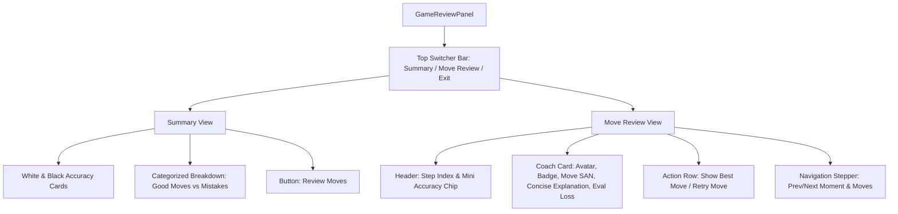

# Rencana Pembaruan UI/UX Game Review & AI Coach

Dokumen ini merinci rencana peningkatan UI/UX [`src/ui/hud/game_review_panel.tscn`](src/ui/hud/game_review_panel.tscn) dan optimasi narasi AI Coach pada [`src/core/coach_explanation_generator.gd`](src/core/coach_explanation_generator.gd).

---

## 1. Arsitektur Layout & Segmented View

Untuk memastikan seluruh elemen kartu dan antarmuka muat di dalam batas window (fit pada 720×1280 maupun skala window override), antarmuka Game Review dibagi menjadi dua sub-tampilan yang dapat dialihkan secara instan melalui Segmented Switcher:

### Keunggulan Desain:

1. **Fit Sempurna di Window**: Masing-masing tampilan memiliki tinggi terkontrol (~220–240px), sehingga tidak menyebabkan container induk [`CenterContainer/MainLayout`](src/main.tscn:146) meluap melebihi 1280px.
2. **Terstruktur & Terkategori**: Data langkah dikelompokkan rapi ke dalam dua kategori jelas:
   - **Good Moves**: Brilliant (!!), Great (!), Best (★), Excellent (✓), Book (📖).
   - **Mistakes & Flaws**: Inaccuracy (?!), Mistake (?), Miss (✕), Blunder (??).
3. **Penyelarasan Font (Readable)**: Tidak ada lagi teks berukuran kecil 12px yang sulit dibaca.

---

## 2. Penyelarasan Tipografi & Skala Font

| Elemen UI                    | Ukuran Lama | Ukuran Baru | Varian / Bobot | Keterangan                         |
| :--------------------------- | :---------: | :---------: | :------------: | :--------------------------------- |
| Skor Akurasi (%)             |    18px     |  **22px**   |  `LabelBold`   | Menonjol dan kontras               |
| Judul Kartu Akurasi          |    12px     |  **14px**   |    Regular     | "White Accuracy", "Black Accuracy" |
| Badge Klasifikasi Langkah    |    14px     |  **16px**   |  `LabelBold`   | "★ Best Move", "?? Blunder"        |
| Notasi Langkah (SAN)         |    14px     |  **16px**   |  `LabelBold`   | "12. Nf3", "15... exd4"            |
| Narasi AI Coach              |    13px     |  **15px**   |    Regular     | Autowrap, kontras tinggi           |
| Eval Loss Tag                |    12px     |  **14px**   |  `LabelBold`   | "Eval Loss: -1.25 pawns"           |
| Kategori Breakdown (Summary) |    12px     |  **14px**   |     Medium     | Icon + Nama + Counter              |
| Tombol Aksi & Navigasi       |   12–13px   |  **14px**   | Medium / Bold  | Mudah ditekan                      |

---

## 3. Istilah Catur (English Chess Terminology)

Sesuai instruksi, seluruh terminologi catur dipertahankan dalam bahasa Inggris:

- **Akurasi**: `White Accuracy`, `Black Accuracy`
- **Klasifikasi**: `Brilliant Move`, `Great Move`, `Best Move`, `Excellent Move`, `Good Move`, `Book Move`, `Inaccuracy`, `Mistake`, `Miss`, `Blunder`
- **Perwira & Papan**: `King`, `Queen`, `Rook`, `Bishop`, `Knight`, `Pawn`
- **Konsep Taktis & Posisi**: `Checkmate`, `Forced Mate`, `Castling`, `Fork`, `Pin`, `Skewer`, `Hanging Piece`, `Passed Pawn`, `Tempo`, `Initiative`, `Center Control`, `Material Advantage`, `Eval Loss`
- **Tombol**: `Show Best Move`, `Retry Move`, `Review Moves`, `Key Moments`

---

## 4. Optimasi & Ringkasan Narasi AI Coach ([`src/core/coach_explanation_generator.gd`](src/core/coach_explanation_generator.gd))

Semua kalimat basa-basi dieliminasi agar informasi taktis langsung tersampaikan secara efisien:

| Klasifikasi / Motif | Narasi Sebelumnya (Bertele-tele)                                                   | Narasi Baru (Ringkas & Optimal)                            |
| :------------------ | :--------------------------------------------------------------------------------- | :--------------------------------------------------------- |
| **Brilliant**       | _"Luar biasa! Pengorbanan perwira yang sangat visioner. %s"_                       | **"Brilliant sacrifice! %s"**                              |
| **Great**           | _"Langkah krusial! Kamu menemukan solusi tunggal terbaik di posisi ini. %s"_       | **"Great find! Solusi terbaik di posisi ini. %s"**         |
| **Best**            | _"Tepat sekali! Langkah paling akurat menurut engine. %s"_                         | **"Best move. Menjaga inisiatif dan dominasi posisi. %s"** |
| **Excellent**       | _"Langkah yang sangat solid. Menjaga tekanan dan struktur posisi dengan mantap."_  | **"Excellent. Posisi solid dan mempertahankan kendali."**  |
| **Good**            | _"Langkah wajar dan aman. Permainan tetap seimbang dan terarah."_                  | **"Good move. Posisi tetap seimbang."**                    |
| **Book**            | _"Langkah standar teori pembukaan catur resmi."_                                   | **"Opening book move."**                                   |
| **Inaccuracy**      | _"Langkah ini melepaskan sedikit keunggulan. %s Langkah terbaik adalah %s (%s)."_  | **"Inaccuracy. %s Best move: %s (%s)."**                   |
| **Mistake**         | _"Sayang sekali, ini kesalahan taktis. %s Seharusnya kamu melangkah %s untuk %s."_ | **"Mistake. %s Best move: %s (%s)."**                      |
| **Miss**            | _"Kamu melewatkan peluang emas! %s Langkah %s memberikan %s."_                     | **"Missed chance! %s Best move: %s (%s)."**                |
| **Blunder**         | _"Aduh, ini blunder fatal! %s Langkah terbaik adalah %s (%s)."_                    | **"Blunder! %s Best move: %s (%s)."**                      |
| _Checkmate_         | _"Skakmat sempurna! Raja lawan tidak memiliki petak lari."_                        | **"Checkmate! Raja lawan tidak dapat meloloskan diri."**   |
| _Forced Mate_       | _"Mengunci raja musuh dalam jaring skakmat paksa (%d langkah lagi)."_              | **"Forced mate dalam %d langkah."**                        |
| _Winning Queen_     | _"Berhasil memenangkan Menteri lawan yang sangat berharga!"_                       | **"Memenangkan Queen lawan."**                             |
| _Hanging Queen_     | _"Menteri kamu sekarang gantung dan bisa dimakan gratis oleh lawan!"_              | **"Hanging Queen! Queen tidak terjaga."**                  |
| _Fork_              | _"Taktik garpu (fork) ganda yang brilian terhadap dua perwira musuh sekaligus!"_   | **"Fork taktis menyerang dua sasaran sekaligus."**         |
| _Pin_               | _"Memaku perwira musuh ke sasaran vital di belakangnya (pin taktis)."_             | **"Pin taktis menekan perwira lawan."**                    |
| _Winning Material_  | _"Memenangkan materi perwira musuh dan memperkuat dominasi papan."_                | **"Memenangkan material perwira lawan."**                  |
| _Hanging Piece_     | _"Bidak kamu di %s tidak terjaga dan bisa ditangkap lawan secara cuma-cuma."_      | **"Hanging piece di %s tanpa perlindungan."**              |
| _Castling_          | _"Rokade yang aman, melindugi raja dan mengaktifkan benteng ke jalur tengah."_     | **"Castling mengamankan King dan mengaktifkan Rook."**     |
| _Passed Pawn_       | _"Mendorong pion bebas maju mengancam promosi dan menekan pertahanan lawan."_      | **"Passed pawn maju mengancam promosi."**                  |

---

## 5. Koordinasi Layout & Window Fit di [`src/main.gd`](src/main.gd)

- Saat mode review dimulai (`start_game_review()`):
  - Sembunyikan kontrol permainan biasa yang tidak relevan: `game_controls.visible = false`.
  - Memberikan ruang ekstra bagi [`HUDTabContainer`](src/main.tscn:418) sehingga Game Review Panel memiliki ruang lapang tanpa memicu scrolling atau desakan window.
- Saat mode review ditutup atau permainan baru dimulai (`start_new_game()` / `_on_review_closed()`):
  - Kembalikan `game_controls.visible = true`.

---

## 6. Verifikasi & Pengujian
- Jalankan automated test runner:
  `& "D:\Tools\Godot\Godot_v4.7.2-stable_win64_console.exe" --headless --path . -s res://tests/test_runner.gd`
- Seluruh 229 test cases **PASS (100% Lulus)** tanpa galat skrip, regresi runtime, atau kegagalan assertion string.

## 7. Status Eksekusi
- **STATUS:** SELESAI (COMPLETED)
- Seluruh aturan anti-slop, zero-emoji, tipografi berukuran proporsional (14-22px), kalimat coach ringkas, istilah catur bahasa Inggris, dan layout window fit telah diintegrasikan.
- `AGENTS.md` diperbarui dengan aturan adaptasi error, penjagaan hierarki node, dan arsitektur anti-slop UI.
